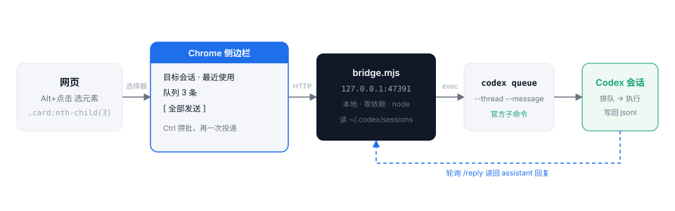
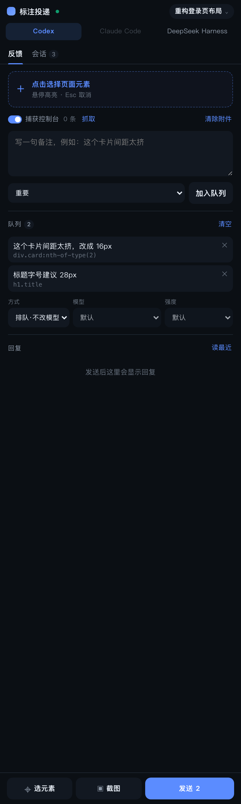

<div align="center">

<h1>annotation-bridge</h1>

<sub>在网页上标注元素、写下意见，一次性投递到 <b>Codex / Claude / DeepSeek Harness</b> 的会话，并显示回复和调用链。<br/>配一个菜单栏 App，点一下弹出标注面板。</sub>

<br/><br/>


</div>

---

## 它解决什么

对着网页改 UI 的时候，你现在的流程大概是：

> 看页面 → 心里记着"那个卡片""右边那个按钮" → 切到终端 → 用文字描述它在哪 → agent 猜错 → 再描述一遍

**annotation-bridge 把"描述"换成"指给 agent 看"**——你直接点元素，它拿到的是 `.card:nth-of-type(3)` 这种 agent 能直接 grep 的东西。

而且不用一条一条发：攒一批，一次性投递。

---

## 支持哪些会话

| 工具 | 列会话 | 发消息 | 换模型 | 换推理强度 | 读调用链 |
|---|---|---|---|---|---|
| **Codex** | ✅ 去重后按最近使用 | ✅ `codex queue`（排队，注入正在跑的会话） | ⚠️ 仅「续跑」模式：`codex exec resume -m` | ⚠️ 仅「续跑」模式：`-c model_reasoning_effort=` | ✅ |
| **DeepSeek Harness** | ✅ 解压 `session.v4.jsonl.zstd` | ⚠️ 只能投递 headless 建的会话（见下） | ❌ headless 没有 model 参数 | ❌ | ✅ |
| **Claude Code** | ✅ 读 `~/.claude/projects` | ⚠️ 需要 `claude` CLI（本机未安装，页面里显示为灰） | ✅ `--resume -p --model` | — | ✅ |

模型列表和每个模型支持的强度**不是写死的**，启动时跑 `codex debug models` 拉官方目录：

```text
gpt-6.1-sol     default=low     支持=low,medium,high,xhigh,max,ultra
gpt-6-astra     default=medium  支持=low,medium,high,xhigh,max,ultra
gpt-6-luna      default=medium  支持=low,medium,high,xhigh,max
```

面板里选了模型，强度下拉只列这个模型真支持的档位。

> **DSH 的硬限制**：`dsh --profile headless --session-id` 只能接管**没有 agent preset** 的会话。
> 网页 / 桌面里建的会话都会记录 preset（`standard`、`cordis` 等），一次性 Runner 会直接拒绝
> （`runs under agent preset ... which the one-shot runner does not compose`）。
> 所以面板里这类会话会标 **「只读」**：能读历史，不能投递。要投递就用 Codex，或者用 headless 新建的会话。

**给 DSH headless 配模型凭据**

headless profile 默认走 `deepseek-official`，需要 `DEEPSEEK_API_KEY`；DSH 启动时会读 `~/.dsh/.env`：

```bash
./scripts/set-deepseek-key.sh     # 交互式输入，写入 ~/.dsh/.env（chmod 600）
```

这个文件在仓库外，`.gitignore` 也兜底忽略了 `.env` / `.env.*` / `*.key`。
配好后 `dsh --profile headless --json "只回复 ok"` 能返回内容，面板里 headless 建的会话就可以直接投递了。
（headless runner 还要求运行时目录和会话记录的目录一致，bridge 会自动用会话的 cwd。）

**排队 ≠ 续跑**，这两个不是一回事：

- **排队（queue）** —— 把消息塞进**正在跑**的那个会话的队列。**任何 `-c` 覆盖都会被拒绝**（`cannot queue through an embedded app server while a local app-server daemon is running`），所以模型和强度都不能换。适合"我一边看着它干活，一边插话"。
- **续跑（resume / headless / print）** —— 起一个**独立进程**接上同一个会话，能把模型换掉。适合"这批改完就用 X 模型重跑一遍"。两个进程同时挂同一个会话会打架。

## 演示

**① 选会话**

侧边栏列出你最近用过的 Codex 会话（按 `~/.codex/sessions` 里最后修改时间排序），点一个就行。也可以直接粘贴会话 UUID。

**② 点元素，写备注**

点「选择元素」，页面进入拾取模式（元素高亮、顶部提示条）。点一下目标元素：

```text
body > main > .card:nth-of-type(3)
div · BR 36 / 40 · N/30 对照
```

再写一句 `这个卡片间距太挤`，选严重度，**加入队列**。

**③ 全部发送**

队列里攒了 3 条，点「全部发送」，bridge 把它们合成一条消息：

```markdown
【网页标注 · 3 条】 来源：http://127.0.0.1:8080/review/

我在页面上标了下面几处，请按选择器定位代码后逐条修改：

1. `body > main > .card:nth-of-type(3)`
   元素文本：BR 36 / 40 · N/30 对照
   严重度：important
   备注：这个卡片间距太挤

2. `h1.title`
   严重度：suggestion
   备注：标题字号建议 28px

改完逐条说明改了什么。
```

然后面板自动轮询，把 Codex 的回复贴回来。

> 真实回执（本机跑出来的）：
> ```json
> {"count": 2, "thread": "01a18c4a-…", "ok": true,
>  "cmd": "codex queue --thread 01a18c4a-… --message <218 字> --resume"}
> ```

---

## 安装

### 1. 起 bridge

```bash
git clone https://github.com/AAAAAAQQQQQ/annotation-bridge.git
cd annotation-bridge
./start.sh
```

看到 `[annotation-bridge] http://127.0.0.1:47391` 即可。零依赖，只要 Node ≥ 20。

### 2. 装扩展

1. Chrome 打开 `chrome://extensions`
2. 右上角开 **开发者模式**
3. **加载已解压的扩展程序** → 选 `extension/` 目录

> **装不上？** 正式版 Chrome 从 137 起不再支持 `--load-extension` 命令行参数（静默忽略、不报错），
> 只能用 `chrome://extensions` 手动加载。原因和实测记录见 [docs/loading-unpacked-extensions.md](docs/loading-unpacked-extensions.md)。

#### 推荐：装原生消息宿主（不需要端口）

```bash
cd ~/Project/annotation-bridge && ./install-native.sh
```

装完之后扩展通过 **Chrome 原生消息**跟本地进程通信：不经浏览器网络层，**不受 LNA 限制**，也不需要提前启动任何服务
（Chrome 会在第一次用到时自动拉起宿主，宿主再自动拉起 bridge）。

不装也能用，但走 HTTP 回退路径，Chrome 142+ 会被 LNA 拦。

#### 连不上本地服务？

Chrome 从 **142** 起默认启用 **Local Network Access**：从公共来源访问 `127.0.0.1` 需要用户授权，
而扩展页拿不到那个授权弹窗，请求会被直接拦掉（报 `Failed to fetch`，和"服务没开"一模一样）。

打开 `chrome://flags/#local-network-access-check` → 设为 **Disabled** → 重启浏览器。

### 3. 装桌面 app（可选但推荐）

```bash
./app/build.sh
```

之后从 `~/Applications/标注投递.app`（或聚焦搜索）启动：菜单栏多一个图标，
点「打开标注面板」就会弹出一个独立的面板窗口，不用去翻 Chrome 工具栏。

### 4. 用

两种打开方式：

- 点 Chrome 工具栏的扩展图标 → 侧边栏弹出
- 点菜单栏的 **标注投递** → **打开标注面板** → 独立窗口弹出

> 装完原生宿主或改了 `background.js`，记得重启 Chrome / 在 `chrome://extensions` 点一次刷新。

---

## 工作原理

<div align="center">
  
</div>

关键点：**投递走的是 Codex 官方子命令**，不是逆向：

```bash
codex queue --thread <session-uuid> --message "<text>" --resume
```

`--resume` 表示：如果那个会话当前没有进程在跑，试着把它拉起来。

回复则是读会话 jsonl 里的 `response_item` / `message` / `role=assistant`。

---

## 界面

<div align="center">
  
  <br/>
  <sub>真机截图 · Chrome for Testing 148 · 三个工具可切换、可选发送模式和模型</sub>
</div>

---

## HTTP 接口

bridge 就监听在 `127.0.0.1:47391`，不连外网。你可以直接拿它当 CLI 用：

| 方法 | 路径 | 说明 |
|---|---|---|
| GET | `/health` | 存活 + pid/版本/扩展是否连上 |
| POST | `/open-panel` | 让 Chrome 里的扩展弹出面板窗口 |
| GET | `/command` | 原生宿主每秒来取命令（同时是扩展在线心跳） |
| POST | `/shutdown` | 停掉服务（桌面 app 用它） |
| GET | `/sessions?limit=60` | 会话列表（5 秒缓存） |
| GET | `/messages?thread=&limit=` | 某会话最近消息 |
| POST | `/queue` | 入队 `{thread, comment, selector, text, url, severity}` |
| GET | `/queue?thread=` | 查队列 |
| POST | `/queue/clear` | 清空 |
| POST | `/send` | 投递该会话的整个队列 |
| GET | `/reply?thread=&since=` | 投递之后的新回复 |

```bash
curl -s 127.0.0.1:47391/health
curl -s '127.0.0.1:47391/sessions?limit=5' | jq '.sessions[] | {id, project, title}'
```

---

## 一些实现细节

**会话去重** —— 一个 Codex 会话会往磁盘写多个 `rollout-*.jsonl`（同一个 `session_id`）。直接列目录会看到一堆重复项，所以按 `session_id` 去重，只留最新的文件。

**只读文件头** —— `~/.codex/sessions` 可能有几个 GB，扫的时候只读每个文件的前 256KB 拿元信息，不整文件读。

**选择器稳定性** —— 优先级 `#id` → `[data-*]` → `tag.class:nth-of-type(n)` 链（最多 6 层），并过滤 `active` / `hover` / `is-*` 这类状态类名，避免选择器随交互变化。

**CORS** —— 扩展走 `host_permissions` 直连 localhost，不依赖服务端放行。

---

## 已验证

`test/probe.mjs` 会真的把扩展装进 Chrome、打开面板、往测试页点一个元素、入队、发送，并打印每一步：

```text
✅ 扩展已加载  id = cghelop…
✅ 侧边栏页面已打开
   面板状态: {"status":"已连接 · 6 个会话","sessions":6}
   进入拾取模式: {"ok":true}
   拾取结果回传面板: {"selector":"div.card:nth-of-type(2)","text":"div · 卡片二 目标簇数 261 ± 20"}
   入队后: {"count":"1","items":1}
   发送后: {"hint":"已投递 1 条（DRY_RUN），等待回复…"}
```

自己跑：

```bash
DRY_RUN=1 node bridge.mjs &    # 安全模式：只合成消息，不真的投递
node test/serve.mjs &
node test/probe.mjs
```

**原生通道**（不需要端口转发、不需要关 LNA）单独测：

```bash
node test/native-probe.mjs       # 宿主拉起 bridge + 面板走原生通道
node test/open-panel-probe.mjs   # 桌面 app 的「打开面板」整条链路
node test/pick-probe.mjs         # 独立窗口里选元素：列表、定位、✕ 同步删除
```

两个脚本都会自己起一个隔离端口的 bridge + 全新 Chrome profile，不会碰你正在用的服务。

> `DRY_RUN=1` 不能省——否则真的会往你选中的那个会话里投消息。

---

## 已知限制

1. **Claude 只有只读那一半。** 这台机器上没装 `claude` CLI，所以 Claude 页签是灰的，只能读历史不能发。装好 CLI 后适配器已经就位（`claude --resume <id> -p --model <m>`）。
2. **「排队」不等于「立即执行」。** 消息进的是该会话的队列，能不能立刻跑取决于 Codex 的 app-server 状态。
3. **换模型的代价。** Codex 换模型必须走 `codex exec resume`，这会在新进程里跑一轮完整对话——耗时和 token 都按一整轮算，不是"改个设置"。
4. **同一个会话别开两个进程**，消息归属会乱。
5. **回复轮询上限 3 分钟**，超时手动点「读最近」。
6. **正在跑、还没落盘的当前轮**可能不在会话列表里。
7. 桌面 app 的菜单点击没法自动化（只能测到 CLI 和唤起链路），面板 UI 有 `test/probe.mjs` 和 `test/open-panel-probe.mjs` 两个自动测试兜着。

---


## 排障

**`Specified native messaging host not found`**
宿主清单的位置跟 **user-data-dir** 走，不总是家目录：

- 默认 profile：`~/Library/Application Support/Google/Chrome/NativeMessagingHosts/com.gjr.annotation_bridge.json`
- 自定义 `--user-data-dir=/x`：清单必须放 `/x/NativeMessagingHosts/`
- Chrome for Testing 默认：`~/Library/Application Support/Google/Chrome for Testing/NativeMessagingHosts/`

`./install-native.sh` 会写前面三个默认位置。装完**重启 Chrome** 才会重新读清单。

**工具全灰 / DSH 会话没有名字**
Chrome 从 Dock 启动时 `PATH` 只有 `/usr/bin:/bin`，`codex`、`zstd` 都找不到。
bridge 启动时会自己补 `/opt/homebrew/bin` 等常见路径（`bridge.mjs` 顶部的 `EXTRA_PATH`），宿主拉 bridge 时也会补一次。
如果还是灰的，重启一次服务（桌面 app → 重启服务）即可。

**改了扩展代码没生效**
`background.js` 改动需要到 `chrome://extensions` 点一下刷新，或者重启 Chrome；
只改 `sidepanel.js` / CSS 的话，重开面板窗口就行。

**`pkill -f "node bridge.mjs"` 杀不掉**
实际命令行是 `node /Users/xxx/Project/annotation-bridge/bridge.mjs`，中间隔着绝对路径。
用 `pkill -f annotation-bridge/bridge.mjs`，或者直接点桌面 app 的「停止服务」（走 `POST /shutdown`）。

## License

MIT © 2026 A_hua

---

## 开机自启（launchd）

仓库里已生成好 `~/Library/LaunchAgents/com.gjr.annotation-bridge.plist`（`RunAtLoad` + `KeepAlive`）。装一次，以后开机自动在后台跑 bridge。

**在你自己的 Terminal 里执行**（DSH 沙箱里 `launchctl` 会被挡住）：

```bash
launchctl bootstrap gui/$(id -u) ~/Library/LaunchAgents/com.gjr.annotation-bridge.plist
```

确认：

```bash
launchctl list | grep annotation-bridge   # 应有一行
curl -s 127.0.0.1:47391/health            # {"ok":true,...}
```

卸载：

```bash
launchctl bootout gui/$(id -u)/com.gjr.annotation-bridge
```

日志：`~/Library/Logs/annotation-bridge.log` 和 `.err.log`

## 选元素：怎么让人不选错

一次标注可以覆盖多个元素：进入拾取模式后**连续点击**要标注的元素，再点一次取消，**Enter** 结束、**Esc** 随时退出（焦点在页面或面板里都行）。

拾取时的约定：

- 光标变成**十字**，页面暂时不能选字
- **鼠标划过 = 虚线浅框预览**，**点下去 = 实线 + 编号**
- 划过已经选中的元素，只显示「已选 · 点击取消」，不会再叠一个预览框
- 点到页面空白（html/body）直接忽略，不会出现"整页被框住"
- 滚动页面时，编号框跟着元素走，不会错位

选完后面板里是一张清单，每行：

| 位置 | 含义 |
|---|---|
| 第一行 | 元素文本（没有文字就显示标签），这是人认得出的一条 |
| 第二行 | 选择器 + 尺寸，这是要发给 agent 的 |
| ⌖ | 在页面上定位（黄框闪一下） |
| ↑ | **改成选它的上一层**：点到文字/图标、想选整张卡片时用 |
| ✕ | 从选择里删掉（页面侧同步删，不会下次又冒出来） |

鼠标**划过清单某一行**，页面上会立刻用黄框把那个元素标出来，不用点。

## 截图 / 贴图

三种方式都能拿到图片，都会先打开同一个编辑器（画**矩形 / 圈 / 箭头 / 文字**，选颜色、撤销，保存后才作为附件）：

- **截图** —— 截当前网页可见区域
- **贴图** —— 直接 ⌘V 粘贴剪贴板里的图片，或点「贴图 ⌘V」，或把图片文件拖进面板

贴进来的图同样可以画标注，不会因为不是截图就少功能。

**图片怎么送到模型**：走「续跑」模式时，bridge 会把这些 PNG 用 `codex exec resume ... -i <png>` 传过去，
模型是**真的看到图**，不是读路径。排队模式没有图片通道，只会带上文件路径——面板会提示这一点。

## 桌面应用：标注投递.app

```bash
cd ~/Project/annotation-bridge && ./app/build.sh
```

装到 `~/Applications/标注投递.app`。不需要 Xcode，用系统里已有的 Python + PyObjC。

启动后是一个**普通 App**（Dock 有图标）+ 一个控制面板窗口，同时也会挂一个菜单栏图标。
菜单栏图标**不是必须的**：如果你的菜单栏已经被微信/钉钉/飞书等占满，系统会把新图标挤到屏幕外，
这时用 Dock 图标（或 Spotlight 搜「标注投递」）打开控制面板就行，功能完全一样。

控制面板里有：

- 顶部是状态：**绿点** = 服务在跑且扩展已连上，**橙点** = 服务在跑但扩展没连，**灰点** = 服务停了
- **打开标注面板** —— 让 Chrome 里的扩展弹出一个独立的 440×940 面板窗口（不是标签页）
- 启动 / 停止 / 重启服务，复制服务地址（服务意外挂了会在 10 秒内自动拉回来；点「停止」后不打扰）
- 打开日志、打开项目目录、登录时自动启动（写一个 LaunchAgent）

关掉窗口不会退出 App，点 Dock 图标可以再打开。勾了「登录自启」之后开机是静默启动（`--quiet`，不弹窗），Dock 图标一直在。

**它怎么唤起面板**：app → `POST /open-panel` → bridge 排队一条命令 → 原生宿主每秒取一次 → 推给扩展 service worker → `chrome.windows.create` 弹窗。
Chrome 不允许从外部直接打开 `chrome-extension://` 页面（`open`、`--app`、AppleScript 都会被挡），所以走这条原生消息回推的链路。

命令行同样可用（脚本/自动化友好）：

```bash
APP="$HOME/Applications/标注投递.app/Contents/MacOS/AnnotationBridge"
"$APP" --status        # {"ok":true,"extension":true,"pid":...,"version":"0.2.0"}
"$APP" --start         # 起服务（已在跑就什么都不做）
"$APP" --stop          # 停服务
"$APP" --restart
"$APP" --open-panel    # 弹面板窗口
"$APP" --selftest      # 只检查 AppKit 链路，不开窗口
```

配置可选，换端口/换项目就能复用这个壳：`~/Library/Application Support/AnnotationBridge/config.json`

```json
{"name":"标注投递","port":47391,"projectDir":"~/Project/annotation-bridge","entry":"bridge.mjs"}
```

服务日志：`~/Library/Logs/annotation-bridge.log`；app 自身日志：`~/Library/Logs/annotation-bridge-app.log`。

## 采集：控制台 + 截图

- **控制台 + 网络**：`inject-console.js` 在**主世界**（`world: MAIN`）包装 `console.log/info/warn/error`、`fetch`、`XMLHttpRequest`，
  以及 `error` / `unhandledrejection`，通过 `postMessage` 转给隔离世界的内容脚本。网络记录含方法、URL、状态码、耗时，
  4xx/5xx 会带一段响应片段，并监听 `window.onerror` 与 `unhandledrejection`，保留最近 200 条。面板里点「读取日志」会把日志存到 `~/.annotation-bridge/captures/<id>.json`，随标注一起投递（消息里带错误/warn 摘要）。
计数每 3 秒自动刷新；如果显示「未注入」，说明这个页面是在扩展加载前打开的——点「读取日志」会补注入（只对之后的输出有效），刷新页面则能从开头捕获。

**已经发生过的请求也能抓到**：点「读取日志」时还会读 `performance.getEntriesByType('resource')`，
把页面加载至今所有资源的耗时按慢到快排出来（注入前发生的也在），并带上网关级导航耗时。
投递给 agent 的消息里会有这样一段：

```text
## 页面日志 / 网络（错误与慢请求）
- [页面] TTFB 812ms · DCL 1500ms · load 2400ms
- [慢 2300ms] fetch http://x/api/slow (500)
- [error] Uncaught TypeError: x is undefined
```

所以控制台一条日志都没有时，点「读取日志」也不会白点——它会告诉你最慢的是哪几个请求。
- **截图**：`chrome.tabs.captureVisibleTab` 抓当前可见区域，存成 PNG，路径写进投递消息。
- 两条都会作为「附件」挂在标注上，入队后清空。
